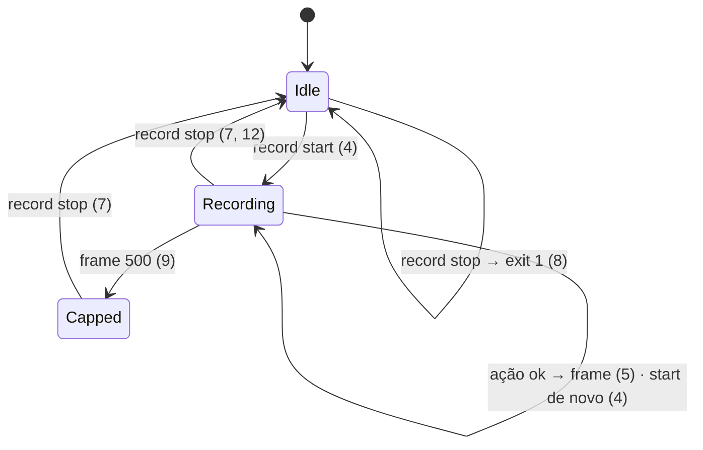
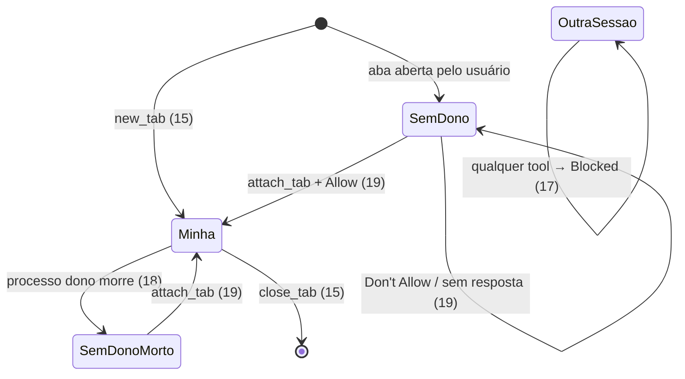

# 01 — Criteria · States · Observable · Swept

## Criteria

### `allow --json`

1. Quando o usuário roda `zenpilot allow --json`, então o stdout tem uma linha JSON `{"allowlist": [...], "grants": {"<host>": <epoch>}, "allow_all_sites": <bool>}` (só grants vigentes) e o exit é 0, sem alterar a config.
2. Se `--json` vem com domínios ou com `--remove`, então o exit é 2 e o stderr diz "--json only lists; drop the domains/--remove".
3. Sempre, `allow` sem `--json` imprime exatamente o mesmo texto de hoje (`cli.py:218-220`).

### Gravação

4. Quando o usuário roda `zenpilot record start`, então é criado `<STATE_DIR>/recordings/<UTC yyyymmddTHHMMSSZ>/` e `recording.json` (via `save_state`) com `{"dir": ..., "frames": 0}`, e o stdout diz `Recording to <dir>`. Se já há gravação ativa, o stdout diz `Already recording to <dir>` e o exit é 0.
5. Enquanto `recording.json` existir, depois de cada `new_tab`, `navigate`, `click`, `type`, `select`, `upload` e `screenshot` com sucesso, o server salva `NNNN.jpg` (captura com o badge escondido) e uma linha em `frames.jsonl`: `{"n","ts","tool","url","params"}`, com `params` já redigidos como no audit (`text` → `{"chars": N}`).
6. Se a captura do frame falha, então a tool devolve o resultado normal e a falha vai para o audit como `record_error`.
7. Quando o usuário roda `zenpilot record stop`, então: `recording.html` é gerado (frames em base64, legenda `tool · url · hora` escapada, setas ←/→ e play); `recording.gif` também, se `import PIL` funcionar (800 ms por frame); senão o stdout diz `GIF: pip install 'zenpilot[gif]'`. O `recording.json` é removido, e os caminhos saem no stdout.
8. Se não há gravação ativa, então `record stop` diz `Not recording` e o exit é 1.
9. Sempre, a gravação para de capturar no frame 500 e o audit registra `record_cap`.
10. Sempre, `close_tab`, `list_tabs`, `read_page`, `get_text` e `scroll` não geram frame.
11. Sempre, `pyproject.toml` declara `[project.optional-dependencies] gif = ["Pillow>=10"]`; `dependencies` fica igual (`mcp`, `websockets`).
12. Sempre, uma gravação com 0 frames gera um `recording.html` com "No frames recorded" e nenhum GIF.

13. Quando `record start` cria uma gravação, então em `recordings/` são apagados os diretórios cujo nome casa `^\d{8}T\d{6}Z$` e que têm mais de 7 dias (pelo nome), e depois os mais antigos além de 20 (contando a nova). Nunca segue symlink nem toca nada fora de `recordings/`.

### Posse de abas

14. Sempre, `tab_ownership` na config aceita `"strict"` (default), `"sessions"` ou `"off"`; outro valor → `zenpilot config error in <path>: tab_ownership must be strict, sessions or off`.
15. Quando `new_tab` abre uma aba, então `owners-<port>.json` (via `save_state`) registra `{"tN": {"pid": <pid>, "since": <epoch>}}`; `close_tab` remove a entrada.
16. Dado `strict`, quando uma tool que resolve a aba via `_tab` (`read_page`, `click`, `type`, `select`, `upload`, `scroll`, `screenshot`, `get_text`, `navigate`, `close_tab`; também com `tab_id` ausente = aba ativa) mira uma aba sem dono vivo, então `Blocked` "Tab tN isn't Claude's. Call attach_tab('tN') to ask the user for it, or open one with new_tab.". `list_tabs`, `switch_tab` e `new_tab` não checam.
17. Dado `strict` ou `sessions`, quando a aba é de outra sessão viva (pid ≠ o meu e `os.kill(pid, 0)` ok), então `Blocked` "Tab tN belongs to another Claude session (zenpilot pid P). Use your own tabs (new_tab).", e `attach_tab` também não a libera.
18. Sempre, um dono com pid morto conta como sem dono.
19. Quando o modelo chama `attach_tab(tab_id)` numa aba sem dono vivo, então aparece o diálogo "Claude wants to control tab tN in Zen:\n<host/path>" com "Don't Allow" e "Allow". Com Allow, o dono passa a ser o meu pid e o retorno é "Attached tN.". Com Don't Allow → `Blocked` "The user didn't give tab tN to Claude. Don't work around it.". Sem resposta → `Blocked` "Nobody answered…" (mesmo texto de `_ask`). Com `prompts=false` → `Blocked` "Prompts are off: ask the user to open the page with new_tab or to set tab_ownership.".
20. Se a aba já é minha, então `attach_tab` responde "tN is already yours." sem diálogo.
21. Dado `strict` ou `sessions`, quando `list_tabs` lista, então cada linha ganha `[yours]`, `[other session]` ou `[not attached]`; com `off`, as linhas ficam como hoje.
22. Dado `off`, então nenhuma checagem de dono roda (o comportamento atual, `server.py:277`).

## States

## Out of scope

- Vídeo (webm/mp4), anotação de clique sobre o frame, upload da gravação — não pedidos.
- Gravar páginas fora da allowlist — o screenshot já é bloqueado por `_tab`.
- Pool de abas e agent IDs de 128 bits (claudezilla) — o pid do processo zenpilot basta para uma máquina.

## Observable

| Surface | Decision | Landing |
| --- | --- | --- |
| CLI `allow --json` | saída e erro | 1, 2 |
| CLI `record start\|stop` | mensagens e exit codes | 4, 7, 8 |
| `recording.html` | vazio · navegação | 12 · 7 |
| badge no frame | escondido | existing — `browser.py:633` |

## Swept

- validation: 2 · failure modes: 6, 8 · idempotency and retry: 4 (start duplo), 8 (stop sem gravação)
- authorization: existing — `_tab` aplica a allowlist antes do screenshot (`server.py:277`) · concurrency and ordering: vários processos zenpilot gravam no mesmo `recording.json`; o número do frame vem de `len(frames.jsonl)` sob `save_state` atômico (`safety.py:180`); uma colisão rara sobrescreve um frame → Unresolved não aberto: aceito, documentado em 02 §Decided 2
- data lifecycle: 9, 13 (retenção), 15 (dono sai no close), 18 (pid morto) · external-dependency failure: 7 (sem Pillow), 6 · state transitions: States · observability: 6, 9 (audit)
