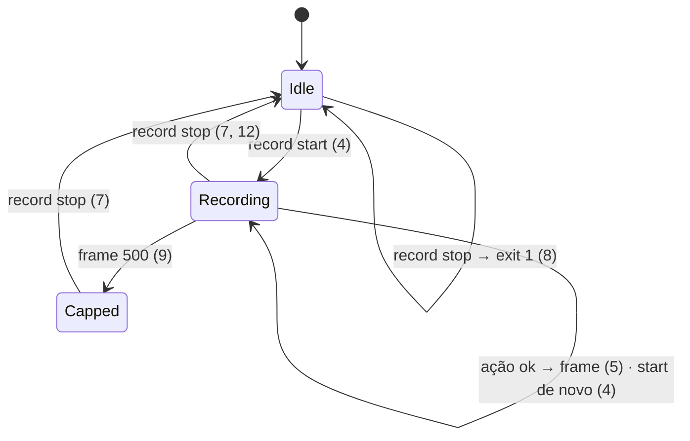

# 01 — Criteria · States · Observable · Swept

## Criteria

### `allow --json`

1. Quando o usuário roda `zenpilot allow --json`, então o stdout tem uma linha JSON `{"allowlist": [...], "grants": {"<host>": <epoch>}, "allow_all_sites": <bool>}` (só grants vigentes) e o exit é 0, sem alterar a config.
2. Se `--json` vem com domínios ou com `--remove`, então o exit é 2 e o stderr diz "--json only lists; drop the domains/--remove".
3. Sempre, `allow` sem `--json` imprime exatamente o mesmo texto de hoje (`cli.py:218-220`).

### Gravação

4. Quando o usuário roda `zenpilot record start`, então é criado `<STATE_DIR>/recordings/<UTC yyyymmddTHHMMSSZ>/` e `recording.json` (via `save_state`) com `{"dir": ..., "frames": 0}`, e o stdout diz `Recording to <dir>`. Se já há gravação ativa, o stdout diz `Already recording to <dir>` e o exit é 0.
5. Enquanto `recording.json` existir, depois de cada `new_tab`, `navigate`, `click`, `type`, `select`, `upload` e `screenshot` com sucesso, o server salva `NNNN.jpg` (captura com o badge escondido) e uma linha em `frames.jsonl`: `{"n","ts","tool","url","params"}`, com `params` já redigidos como no audit (`text` → `{"chars": N}`).
6. Se a captura do frame falha, então a tool devolve o resultado normal e a falha vai para o audit como `record_error`.
7. Quando o usuário roda `zenpilot record stop`, então: `recording.html` é gerado (frames em base64, legenda `tool · url · hora` escapada, setas ←/→ e play); `recording.gif` também, se `import PIL` funcionar (800 ms por frame); senão o stdout diz `GIF: pip install 'zenpilot[gif]'`. O `recording.json` é removido, e os caminhos saem no stdout.
8. Se não há gravação ativa, então `record stop` diz `Not recording` e o exit é 1.
9. Sempre, a gravação para de capturar no frame 500 e o audit registra `record_cap`.
10. Sempre, `close_tab`, `list_tabs`, `read_page`, `get_text` e `scroll` não geram frame.
11. Sempre, `pyproject.toml` declara `[project.optional-dependencies] gif = ["Pillow>=10"]`; `dependencies` fica igual (`mcp`, `websockets`).
12. Sempre, uma gravação com 0 frames gera um `recording.html` com "No frames recorded" e nenhum GIF.

## States

## Out of scope

- Vídeo (webm/mp4), anotação de clique sobre o frame, upload da gravação — não pedidos.
- Gravar páginas fora da allowlist — o screenshot já é bloqueado por `_tab`.

## Observable

| Surface | Decision | Landing |
| --- | --- | --- |
| CLI `allow --json` | saída e erro | 1, 2 |
| CLI `record start\|stop` | mensagens e exit codes | 4, 7, 8 |
| `recording.html` | vazio · navegação | 12 · 7 |
| badge no frame | escondido | existing — `browser.py:633` |

## Swept

- validation: 2 · failure modes: 6, 8 · idempotency and retry: 4 (start duplo), 8 (stop sem gravação)
- authorization: existing — `_tab` aplica a allowlist antes do screenshot (`server.py:277`) · concurrency and ordering: vários processos zenpilot gravam no mesmo `recording.json`; o número do frame vem de `len(frames.jsonl)` sob `save_state` atômico (`safety.py:180`); uma colisão rara sobrescreve um frame → Unresolved não aberto: aceito, documentado em 02 §Decided 2
- data lifecycle: 9, Unresolved 1 · external-dependency failure: 7 (sem Pillow), 6 · state transitions: States · observability: 6, 9 (audit)
