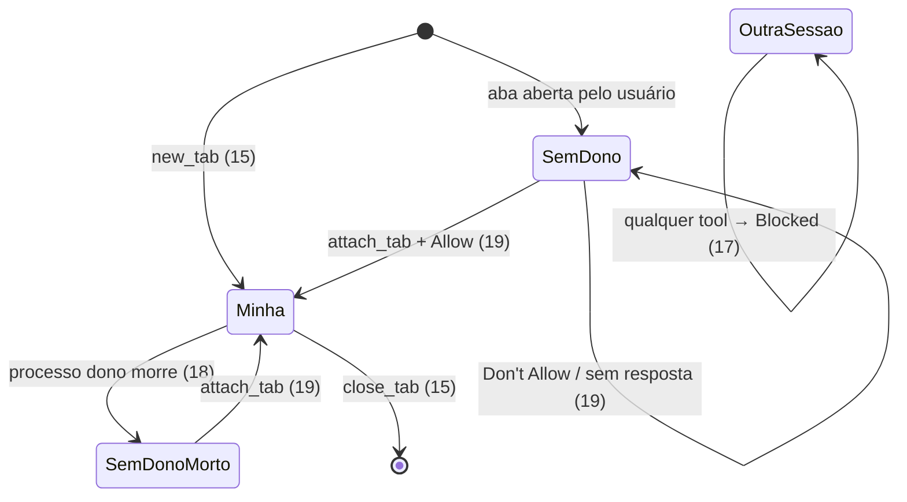

# 01 — Criteria · States · Observable · Swept

## Criteria

### `allow --json`

1. Quando o usuário roda `zenpilot allow --json`, então o stdout tem uma linha JSON `{"allowlist": [...], "grants": {"<host>": <epoch>}, "allow_all_sites": <bool>}` (só grants vigentes) e o exit é 0, sem alterar a config.
2. Se `--json` vem com domínios ou com `--remove`, então o exit é 2 e o stderr diz "--json only lists; drop the domains/--remove".
3. Sempre, `allow` sem `--json` imprime exatamente o mesmo texto de hoje (`cli.py:218-220`).

### Gravação (reusa `runs/` do fork)

4. Quando o usuário roda `zenpilot gif [run]`, então `recording.gif` é escrito no diretório do run (default: o run mais recente em `runs/`, pelo nome) com os `step-*.jpg` em ordem de seq, 800 ms por frame, loop infinito, todos redimensionados ao tamanho do primeiro, e o stdout diz `GIF: <path>` (exit 0).
5. Se o Pillow não está instalado, então `zenpilot gif` diz no stderr `GIF: pip install 'zenpilot[gif]'` e sai com exit 1.
6. Se o run não tem `step-*.jpg` (ou não existe run), então o stderr diz `No step screenshots in <dir>` e o exit é 1.
7. Quando a tool `run_report` escreve o relatório e há steps e o Pillow, então ela também escreve `recording.gif`, e o retorno ganha ` GIF: <path>.`; sem Pillow ou sem steps, o retorno fica igual ao de hoje.
8. Quando `HISTORY.run_dir()` cria o diretório de um run novo, então em `runs/` são apagados os diretórios com nome `^\d{8}T\d{6}Z-[0-9a-f]{4}$` com mais de 7 dias (pela data do nome), e depois os mais antigos além de 20 (contando o novo). Nunca segue symlink, nunca toca nome fora do padrão, e uma falha (OSError) é ignorada.
9. Sempre, `pyproject.toml` declara `[project.optional-dependencies] gif = ["Pillow>=10"]`; `dependencies` não muda.
10. Sempre, o texto digitado nunca aparece no GIF além do que a página mostra (os frames são os mesmos `step-*.jpg`; não há legenda com args).
11. (removido — `record start|stop`: o fork já grava sempre.)
12. (removido — `frames.jsonl`: o fork já tem `report.json`.)
13. (removido — retenção por gravação: substituída pelo 8.)

### Posse de abas

14. Sempre, `tab_ownership` na config aceita `"strict"` (default), `"sessions"` ou `"off"`; outro valor → `zenpilot config error in <path>: tab_ownership must be strict, sessions or off`.
15. Quando `new_tab` abre uma aba, então `owners-<port>.json` (via `save_state`) registra `{"tN": {"pid": <pid>, "since": <epoch>}}`; `close_tab` remove a entrada.
16. Dado `strict`, quando uma tool que resolve a aba via `_tab()` ou via ref (`_check_ref()`) (`read_page`, `click`, `type`, `select`, `upload`, `file_upload`, `form_input`, `hover`, `wait_for`, `scroll`, `screenshot`, `get_text`, `navigate`, `close_tab`; também com `tab_id` ausente = aba ativa) mira uma aba sem dono vivo, então `Blocked` "Tab tN isn't Claude's. Call attach_tab('tN') to ask the user for it, or open one with new_tab.". `list_tabs`, `switch_tab` e `new_tab` não checam.
17. Dado `strict` ou `sessions`, quando a aba é de outra sessão viva (pid ≠ o meu e `os.kill(pid, 0)` ok), então `Blocked` "Tab tN belongs to another Claude session (zenpilot pid P). Use your own tabs (new_tab).", e `attach_tab` também não a libera.
18. Sempre, um dono com pid morto conta como sem dono.
19. Quando o modelo chama `attach_tab(tab_id)` numa aba sem dono vivo, então aparece o diálogo "Claude wants to control tab tN in Zen:\n<host/path>" com "Don't Allow" e "Allow". Com Allow, o dono passa a ser o meu pid e o retorno é "Attached tN.". Com Don't Allow → `Blocked` "The user didn't give tab tN to Claude. Don't work around it.". Sem resposta → `Blocked` "Nobody answered…" (mesmo texto de `_ask`). Com `prompts=false` → `Blocked` "Prompts are off: ask the user to open the page with new_tab or to set tab_ownership.".
20. Se a aba já é minha, então `attach_tab` responde "tN is already yours." sem diálogo.
21. Dado `strict` ou `sessions`, quando `list_tabs` lista, então cada linha ganha `[yours]`, `[other session]` ou `[not attached]`; com `off`, as linhas ficam como hoje.
22. Dado `off`, então nenhuma checagem de dono roda (o comportamento atual, `server.py:277`).

## States

## Out of scope

- Vídeo (webm/mp4), anotação de clique, controle start/stop — não pedidos; o fork grava sempre.
- Pool de abas e agent IDs de 128 bits (claudezilla) — o pid do processo zenpilot basta para uma máquina.

## Observable

| Surface | Decision | Landing |
| --- | --- | --- |
| CLI `allow --json` | saída e erro | 1, 2 |
| CLI `gif` | mensagens e exit codes | 4-6 |
| `run_report` retorno | com/sem GIF | 7 |
| badge no frame | escondido | existing — `browser.py:633` |

## Swept

- validation: 2 · failure modes: 5, 6, 8 (OSError ignorado) · idempotency and retry: `gif` reescreve o mesmo arquivo; `run_report` também
- authorization: existing — `_tab` aplica a allowlist antes do screenshot (`server.py:277`) · concurrency and ordering: dois processos criando run ao mesmo tempo podem apagar o mesmo dir → `shutil.rmtree(..., ignore_errors=True)`; owners: `save_state` atômico com releitura (15)
- data lifecycle: 8 (retenção), 15 (dono sai no close), 18 (pid morto) · external-dependency failure: 5, 7 (sem Pillow) · state transitions: States · observability: existing — audit + run history
