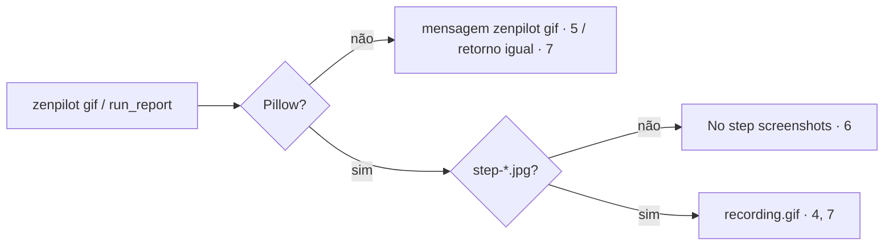

# 02 — Technical (zenpilot fork `main`; âncoras por nome de função — as linhas mudam)

## Impact

| Front | What changes |
| --- | --- |
| CLI | `allow` ganha `--json`; novo subcomando `gif [run]` (parser em `main()` de `cli.py`) |
| server | `run_report` (tool) chama o GIF depois de `write_report`; a retenção fica em `History.run_dir()` (`history.py`), na primeira criação do diretório |
| stored data | `runs/` passa a ter retenção (20 / 7 dias); `owners-<port>.json` novo |
| packaging | extra opcional `gif` |
| server — posse | o ponto único é `_tab()` (`server.py:277`), que já resolve a aba e aplica a allowlist; `new_tab` (`server.py:310`) e `close_tab` (`server.py:334`) gravam/removem o dono; nova tool `attach_tab` com `@tool()`; `list_tabs` (`server.py:295`) marca as linhas |
| config | nova chave `tab_ownership` no `DEFAULT_CONFIG` (`safety.py:17`) e em `Config` (`safety.py:74`) |

## Decided

| Decision | Shape | Alternative rejected |
| --- | --- | --- |
| 1. Contrato `allow --json` | JSON Schema abaixo, uma linha, exit 0 | Parse do texto humano: quebra a cada mudança de cópia |
| 2. Gravação | reusa `runs/` + `step-*.jpg` + `run_report` do fork | `record start\|stop` próprio: duplica o screenshot por ação |
| 4. Default de posse | `tab_ownership = "strict"` (escolha do usuário) | `sessions` como default: deixa o Claude agir nas abas logadas do usuário sem pedir |
| 5. Identidade da sessão | `os.getpid()` + `os.kill(pid, 0)` | ids aleatórios de 128 bits: precisariam de handshake entre processos sem ganho numa máquina só |
| 3. GIF opcional | `zenpilot[gif]` com Pillow; HTML sempre | Pillow obrigatório: diverge do upstream e pesa no `uvx` |

```json
{"type":"object","required":["allowlist","grants","allow_all_sites"],
 "properties":{"allowlist":{"type":"array","items":{"type":"string"}},
  "grants":{"type":"object","additionalProperties":{"type":"number"}},
  "allow_all_sites":{"type":"boolean"}},"additionalProperties":false}
```


## Surface

| Route | In | Out | Status | Criteria |
| --- | --- | --- | --- | --- |
| `zenpilot allow --json` | — | JSON | 0 · 2 | 1-3 |
| MCP `attach_tab(tab_id)` | `tab_id` | `Attached tN.` · `tN is already yours.` | ok · ToolError | 19, 20 |
| `zenpilot gif [run]` | run dir opcional | `GIF: <path>` | 0 · 1 | 4-6 |
| tool `run_report` | — | + ` GIF: <path>.` | ok | 7 |

## Research Completeness Gate

- cadeia (GIF): `_step_shot` → `runs/<run>/step-NNNN.jpg` → `zenpilot gif` / `run_report` → Pillow → `recording.gif`.
- reuse: `History.run_dir`, `_step_shot`, `run_report`, `load_state`/`save_state`, `_tab()`, `dialogs.ask`.
- edge cases (posse): aba ativa do usuário com `tab_id` ausente (16) · pid reaproveitado pelo SO (aceito: raro, só libera uma aba antiga) · dois processos fazendo `new_tab` ao mesmo tempo (`save_state` atômico; o último grava, então cada um relê antes de gravar) · `prompts=false` (19).
- edge cases (GIF): sem Pillow (5) · run sem steps (6) · frames de tamanhos diferentes (4) · symlink/nome estranho em runs/ (8) · corrida na retenção (Swept).

## Sources

- https://github.com/NetVar1337/claude-for-firefox — gif.js no bundle da extensão → gravação.
- https://claude.com/claude-in-chrome — "watch & intervene" → revisão depois.
- conversa 2026-10-29: gravação "Ambos" (HTML sempre + GIF com Pillow opcional); allowlist "Reusar a do zenpilot".

## Gap · impact flow (`RISKS_FOUND`) · BDD flow

| Gap | Critério | Risco | Mitigação |
| --- | --- | --- | --- |
| sem saída de máquina na allowlist | 1-3 | um consumidor lê errado | schema fechado, teste de contrato |
| sem GIF / runs/ sem retenção | 4-9 | disco cresce | retenção 8; `STEP_SHOTS_MAX` existente |


