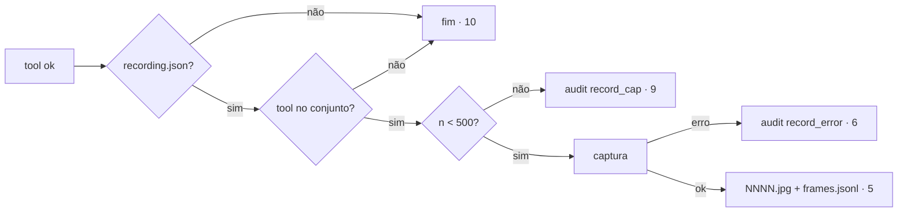

# 02 — Technical (zenpilot @ 8f155ec)

## Impact

| Front | What changes |
| --- | --- |
| domain | novo termo `Recording`: o diretório + o estado `recording.json` em `STATE_DIR` |
| CLI | `allow` ganha `--json` (`cli.py:324`); novo subcomando `record {start,stop}`, registrado em `commands` (`cli.py:350`) |
| server | ponto de captura: o decorator `tool()` (`server.py:118`), dentro de `async with browser.session` logo depois de `browser.mark(..., done=True)` (`server.py:153-154`), só se `ok` e a tool está no conjunto do critério 5; o contexto vem de `_marked.get()` |
| stored data | nada a migrar; arquivos novos em `STATE_DIR/recordings/` |
| packaging | extra opcional `gif` |

## Decided

| Decision | Shape | Alternative rejected |
| --- | --- | --- |
| 1. Contrato `allow --json` | JSON Schema abaixo, uma linha, exit 0 | Parse do texto humano: quebra a cada mudança de cópia |
| 2. Estado da gravação entre processos | `save_state("recording", {...})`, o mesmo padrão das grants | Variável em memória: o CLI e o server são processos diferentes |
| 3. GIF opcional | `zenpilot[gif]` com Pillow; HTML sempre | Pillow obrigatório: diverge do upstream e pesa no `uvx` |

```json
{"type":"object","required":["allowlist","grants","allow_all_sites"],
 "properties":{"allowlist":{"type":"array","items":{"type":"string"}},
  "grants":{"type":"object","additionalProperties":{"type":"number"}},
  "allow_all_sites":{"type":"boolean"}},"additionalProperties":false}
```

`frames.jsonl` (uma linha por frame): `{"n": int, "ts": iso8601, "tool": str, "url": str, "params": object}`.

## Surface

| Route | In | Out | Status | Criteria |
| --- | --- | --- | --- | --- |
| `zenpilot allow --json` | — | JSON | 0 · 2 | 1-3 |
| `zenpilot record start` | — | `Recording to <dir>` | 0 | 4 |
| `zenpilot record stop` | — | caminhos ou `Not recording` | 0 · 1 | 7, 8, 12 |

## Research Completeness Gate

- cadeia: CLI `record` → `recording.json` → `tool()` wrapper → `browser.screenshot` (BiDi `captureScreenshot` JPEG 0.8) → arquivo.
- reuse: `load_state`/`save_state`, `grants()`, `redact`, `audit()`, `browser.screenshot`.
- edge cases: start duplo (4) · stop sem start (8) · captura falha (6) · 500 frames (9) · 0 frames (12) · sem Pillow (7) · `type` com segredo (5, redigido).

## Sources

- https://github.com/NetVar1337/claude-for-firefox — gif.js no bundle da extensão → gravação.
- https://claude.com/claude-in-chrome — "watch & intervene" → revisão depois.
- conversa 2026-10-29: gravação "Ambos" (HTML sempre + GIF com Pillow opcional); allowlist "Reusar a do zenpilot".

## Gap · impact flow (`RISKS_FOUND`) · BDD flow

| Gap | Critério | Risco | Mitigação |
| --- | --- | --- | --- |
| sem saída de máquina na allowlist | 1-3 | um consumidor lê errado | schema fechado, teste de contrato |
| sem gravação | 4-12 | disco cresce | cap 500 + Unresolved 1 |
| — | 5 | ação fica mais lenta gravando | só com gravação ativa |


