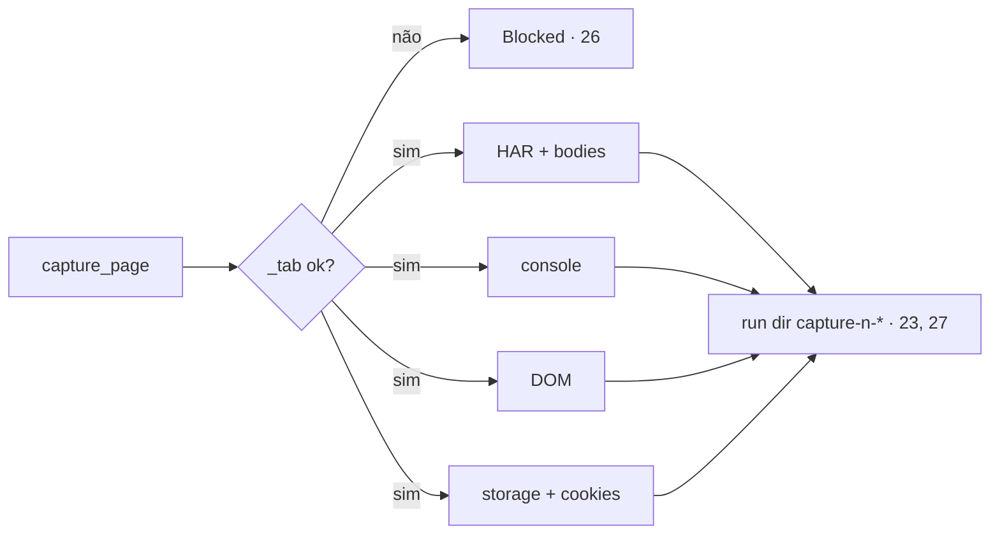

# 03 — `capture_page`: console, requests + responses, DOM, storage e cookies

Pedido (2026-10-29): "Pegar os dados do inspect, console.log, request, response de todas as requests http". Inspect = Console + Network, DOM/acessibilidade, Storage e cookies. Consumidor: `/zen capture` do zen-devtools (critério 29 de lá) e o próprio modelo.

## Criteria

23. Quando a tool `capture_page(tab_id=None)` roda, então na aba resolvida por `_tab()` o zenpilot grava em `HISTORY.run_dir()`, com `n` = 1, 2, … por run: `capture-<n>.har` (`har()` + `_har_bodies()` das requests da aba, corpos ≤ `HAR_BODY_MAX_CHARS`), `capture-<n>-console.json` (`browser.devtools.console(context)`), `capture-<n>-dom.txt` (o mesmo texto que `read_page` devolve) e `capture-<n>-storage.json` (`{"url", "localStorage", "sessionStorage", "cookies"}`). O retorno é `Captured tN: <R> requests, <C> console, <K> cookies → <run dir>/capture-<n>*`.
24. Sempre, os cookies vêm de BiDi `storage.getCookies` com `partition: {"type": "context", "context": <ctx>}` (httpOnly incluídos), com `name`, `value`, `domain`, `path`, `httpOnly`, `secure`, `sameSite` e `expiry`; o valor é guardado por inteiro (decisão do usuário).
25. Sempre, `localStorage`/`sessionStorage` são lidos por um script interno fixo via `browser.evaluate` (não depende de `allow_scripts`, porque não roda código do modelo); cada valor > 10 000 caracteres é cortado com `…`.
26. Se a aba está fora da allowlist ou não é desta sessão (posse, critérios 16/17), então `_tab()` bloqueia como nas outras tools e nada é gravado.
27. Sempre, os arquivos de captura ficam no run dir e seguem a retenção de `runs/` (critério 8); o audit guarda só `tab_id`.

## Decided

| Decision | Shape | Alternative rejected |
| --- | --- | --- |
| 6. Uma tool de captura | `capture_page` grava 4 arquivos e devolve só o resumo | 4 chamadas do modelo (`har_export`, `read_console_messages`, `read_page`, `javascript_tool`): estoura o contexto do modelo e `javascript_tool` exige `allow_scripts` |
| 7. Cookies em texto puro | valor inteiro, só no disco local, no run dir | mascarar (como `redact_headers`): o usuário pediu os cookies |

## Swept · Observable

- validation: `tab_id` inexistente → o erro existente de `browser.tab` · failure modes: um dos 4 pedaços falha → grava os outros e o retorno diz `(<pedaço> failed: <erro>)` · idempotency: `n` sobe, nunca sobrescreve · authorization: 26 · concurrency: `n` vem de `glob('capture-*-console.json')` + 1 dentro do processo · data lifecycle: 27 · external-dependency failure: BiDi `storage.getCookies` indisponível → `cookies: []` e a nota `(cookies failed: …)` · state transitions: n/a · observability: audit existente.
- Observable: o retorno da tool (23) e os 4 arquivos.

## Sources

- https://claude.com/claude-in-chrome — "read console/network/DOM" para debug.
- https://github.com/boot-industries/claudezilla — `firefox_get_page_state`, `firefox_get_accessibility_snapshot`.
- WebDriver BiDi `storage.getCookies` — https://w3c.github.io/webdriver-bidi/#command-storage-getCookies (confirmar o shape exato no teste com Zen real).

