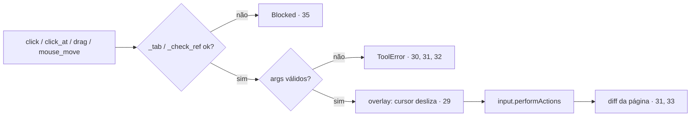

# 04 — Ações de mouse: cursor visível, botões, arrastar, coordenadas

Pedido (2026-10-29): "Incluir navegação da seta do mouse, ações de click, ações de select, todas as ações que o mouse pode fazer". Respostas: **feature + teste**; entram **cursor visível animado, clique duplo e direito, arrastar e soltar, mover por coordenadas**. Já existiam no fork: `click`, `hover`, `select`, `scroll`, `form_input` e o overlay (`show_actions`, `overlay.js`: caixa no alvo, ripple no clique, uma parte `cursor` que hoje salta sem animação).

## Criteria

29. Sempre, com `show_actions = true`, antes de `click`, `click_at`, `hover`, `type`, `select`, `drag` e `mouse_move`, a parte `cursor` do overlay tem forma de seta (SVG de 20 px, cor `#e8590c`, contorno branco) e desliza em 250 ms (`transition` em `left`/`top`) da última posição desenhada naquela página até o ponto da ação. Na primeira ação da página, ela parte do centro da viewport. Continua display-only (`aria-hidden`, `pointer-events: none`) e some com o resto do overlay depois de `FADE_MS`. Com `show_actions = false`, nada é desenhado (existing).
30. Quando `click(ref, button="left", count=1)` roda com `button` ∈ {`left`, `right`, `middle`} (BiDi 0, 2, 1) e `count` ∈ {1, 2}, então `input.performActions` faz `pointerMove` até o elemento e `count` pares `pointerDown`/`pointerUp` com aquele botão. Com os padrões, o comportamento é idêntico ao atual. Valor inválido → `ToolError` "button must be left, right or middle" / "count must be 1 or 2".
31. Quando `drag(from_ref, to_ref)` roda, então: `pointerMove` até o centro de `from`, `pointerDown` (botão 0), 10 `pointerMove` lineares até o centro de `to` (~300 ms no total, via `duration`), `pointerUp`. Os dois refs passam por `_check_ref()` (allowlist + posse). Refs em abas diferentes → `ToolError` "from_ref and to_ref must be on the same tab". O retorno é o mesmo diff de página do `click`.
32. Quando `mouse_move(x, y, tab_id=None)` roda, então o ponteiro vai para (x, y), em pixels CSS da viewport (`origin: "viewport"`), na aba resolvida por `_tab()`. Coordenada fora da viewport → `ToolError` "x, y outside the viewport (<w>x<h>)". Retorno: "Moved to x, y.".
33. Quando `click_at(x, y, button="left", count=1, tab_id=None)` roda, então move até (x, y) e clica com os mesmos `button`/`count` do critério 30, na aba de `_tab()`, com a mesma checagem de viewport do 32. O retorno é o diff de página do `click`.
34. Sempre, `drag`, `mouse_move` e `click_at` são `mutates=True` (o `read_only` bloqueia), entram no audit e no histórico, geram step shot com `capture_actions` e aparecem no `mcpb/manifest.json`. O `browser_batch` aceita os três.
35. Sempre, em `strict`, `drag`, `mouse_move` e `click_at` não agem em aba sem posse: o caminho é `_tab()` / `_check_ref()` (critérios 16, 17).

## Decided

| Decision | Shape | Alternative rejected |
| --- | --- | --- |
| 8. Cursor | animar a parte `cursor` que o `overlay.js` já tem | um segundo overlay: duplicaria o código e o fade |
| 9. Coordenadas | `origin: "viewport"`, pixels CSS | coordenadas de página (com scroll): o modelo vê o screenshot da viewport |
| 10. Drag | `input.performActions` com passos | eventos HTML5 `dragstart` sintéticos: não disparam handlers nativos de `draggable` |

## Swept

- validation: 30, 32, 33 · failure modes: 31 (abas diferentes), 32 (fora da viewport) · idempotency: n/a — ações de UI · authorization: 35 · concurrency: existing — `_busy_input` serializa · data lifecycle: n/a · external-dependency failure: BiDi recusa a ação → o `BrowserError` existente · state transitions: n/a · observability: 34 (audit e histórico)

## Observable

| Surface | Decision | Landing |
| --- | --- | --- |
| página (overlay) | cursor deslizando, ripple no clique | 29 · existing |
| retorno das tools | diff de página / "Moved to" | 31-33 |

